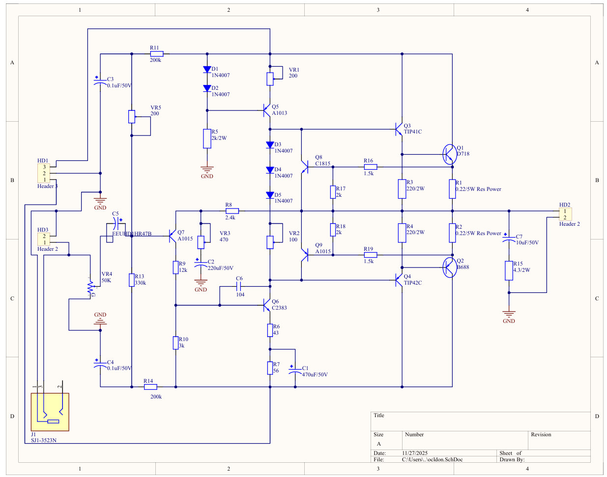
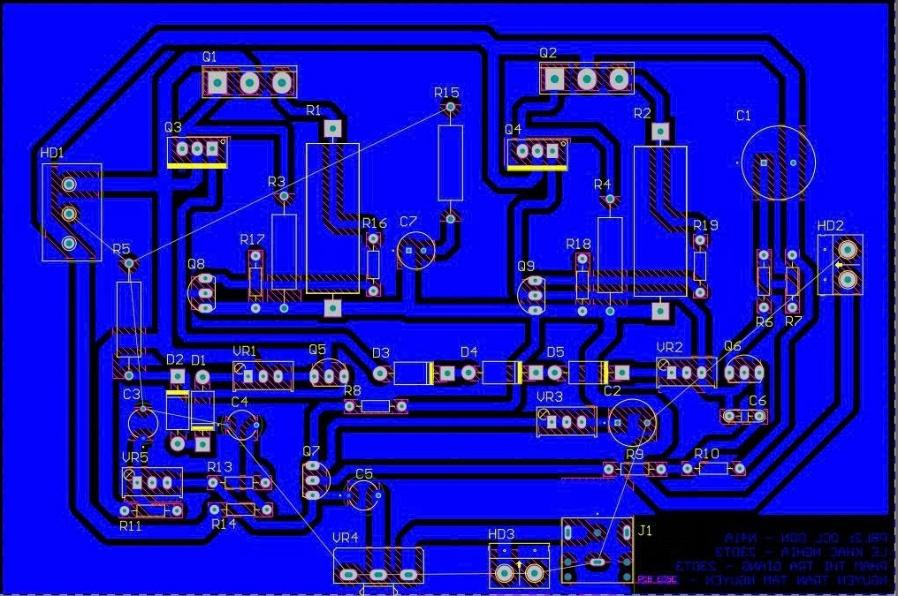
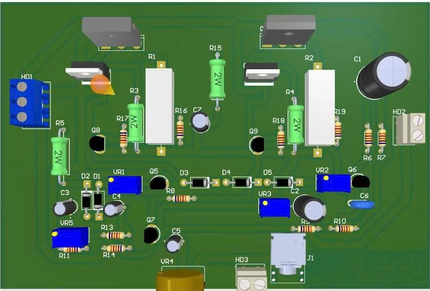
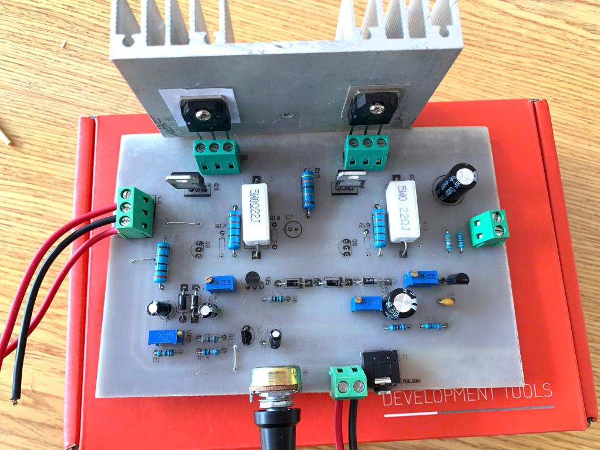
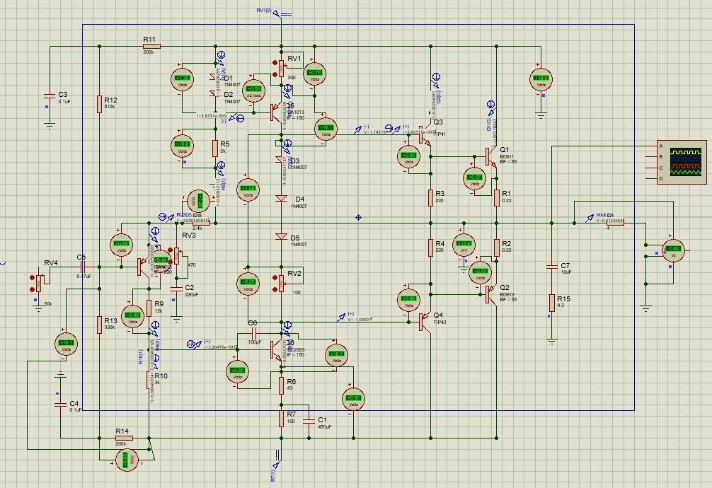
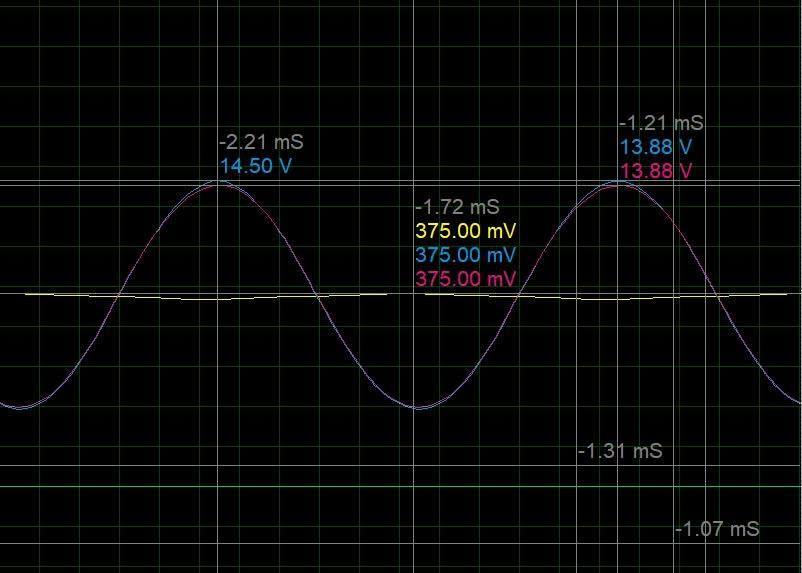
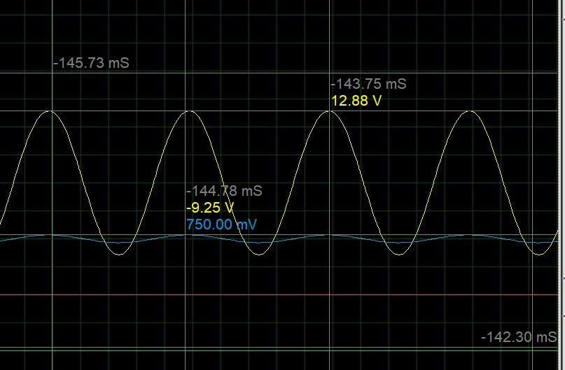
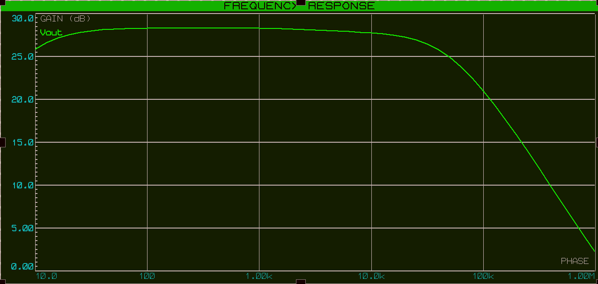
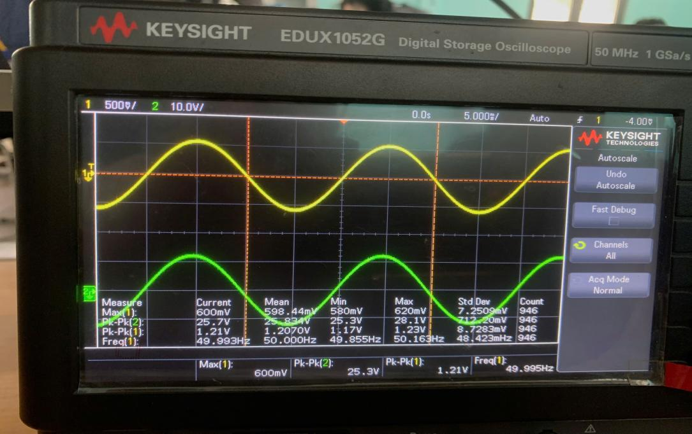
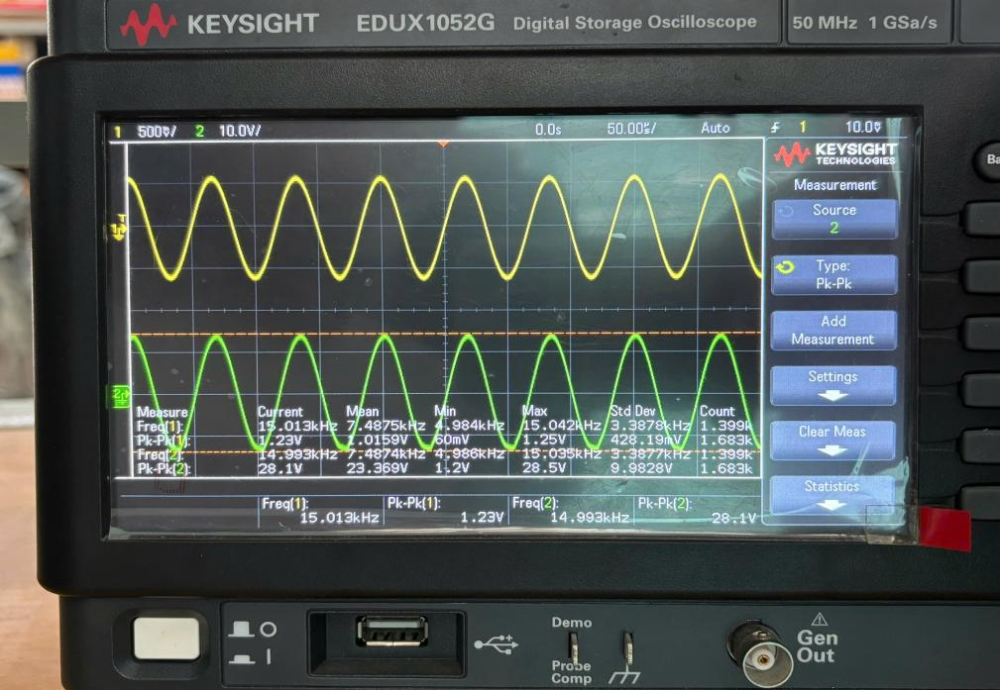

# 🔊 OCL Audio Amplifier - 15W Single-Ended 🔊

## Project Description

This is a group project (PBL 2 – Electronic Circuit Design) aimed at calculating, simulating, designing, and practically implementing a single-ended input OCL amplifier circuit based on given specifications. (Developed at the end of 2025)

Faculty of Electronics and Telecommunications, The University of Danang – University of Science and Technology.
Supervisors: Dr. Huỳnh Thanh Tùng, M.Sc. Vũ Vân Thanh.

## Group Members

- **Lê Khắc Nghĩa**
- **Nguyễn Trần Tâm Nguyên**
- **Phạm Thị Trà Giang**

## Design Requirements

- Amplifier type: OCL (Output Capacitor-Less)
- Input: Single-ended
- Output power: 15W
- Input impedance: 200kΩ
- Input voltage: 0.7V
- Load impedance: 4Ω
- Bandwidth: 50Hz – 15kHz
- Total Harmonic Distortion (THD): ≤ 0.2%

## Circuit Description



The amplifier is built from four parts. Component values are from the final design (see the report in `docs/`).

| Stage | Parts | Role |
|---|---|---|
| Input stage | Q7 (2SA1015), R8–R14, VR3, C2–C5 | Single-ended input (Zin set to 200kΩ); the negative-feedback divider (R8, VR3, C2) is taken from the output and reduces distortion |
| Driver stage | Q6 (2SC2383) with Q5 (2SA1013) as a current source biased by diodes D1–D2 | Voltage gain, and a stable load for the output stage |
| Bias | D3–D5 (1N4007), VR1, VR2 | Biases the output stage in class AB to remove crossover distortion |
| Output stage | Q3/Q4 (TIP41C / TIP42C) + Q1/Q2 (2SD718 / 2SB688), R1/R2 = 0.22Ω/2W, R3/R4 = 220Ω/2W | Two complementary Darlington pairs (common-collector); they drive the 4Ω speaker directly with no output capacitor |
| Protection and filter | Q8/Q9 (2SC1815 / 2SA1015), R16–R19; Zobel network R15 (4.3Ω) + C7 | Current limiting for the output transistors; Zobel network keeps the load stable at high frequency |

## Power Supply

An OCL amplifier needs a dual (positive and negative) supply so the speaker can be connected without a coupling capacitor and the output rests at 0V.

The supply was sized from the output requirement:

| Item | Value |
|---|---|
| Peak load voltage for 15W / 4Ω | V<sub>L</sub> = √(2·P·R<sub>L</sub>) = 10.95V |
| Peak load current | I<sub>L</sub> = 2.74A |
| Supply utilisation (class AB) | ε = 0.8 → V<sub>CC</sub> ≥ 13.75V |
| **Chosen supply** | **±18V (dual)** |
| Average supply power | ≈ 31.4W |
| Efficiency | ≈ 47.8% |

> **TODO:** add a short description of the power-supply hardware you used (transformer, rectifier, filter capacitors) and a photo or schematic, e.g. `images/power_supply.png`:
>
> 

## Circuit Design

The final circuit has one version.

 



## Simulation and Test Results

**DC operating point (simulation):** output mid-point offset 12.4mV (well trimmed); current-source current 5.6mA. Measured transistor bias on the real board matches the simulation closely (for example Q7 V<sub>CE</sub> 8.65V simulated vs 8.44V measured, Q6 16.92V vs 17.3V, Q1 18.9V vs 19.3V).

**AC simulation at 1kHz** (input 0.7V amplitude, output 12.88V amplitude): clean sine with no clipping at the peaks, voltage gain about 18×. 12.88V peak across 4Ω is more than the 10.95V peak needed for 15W.


 

**Frequency response (simulation):** flat across the required 50Hz – 15kHz band.



**Measured on the real board** (oscilloscope, peak-to-peak):

| Frequency | V<sub>in</sub> | V<sub>out</sub> | Gain | Output |
|---|---|---|---|---|
| 50Hz | 1.21V | 25.3V | 20.9 | Clean sine, no clipping |
| 15kHz | 1.23V | 28.1V | 22.85 | Clean sine, no clipping |

 

| Item | Target | Result |
|---|---|---|
| Output power | 15W | Output swing in simulation exceeds the 15W level (see above) |
| THD | ≤ 0.2% | ≈ 0.015% (calculated with feedback; not measured on the board) |
| Input impedance | 200kΩ | By design (R11 = 200kΩ) |
| Bandwidth | 50Hz – 15kHz | Met in simulation and on the board |

## Repository Structure

```
hardware/
  schematic/OCL_15W.SchDoc     Schematic (Altium Designer)
  pcb/OCL_15W.PcbDoc           PCB layout (Altium Designer)
simulation/
  OCL_15W_simulation.pdsprj    Simulation project (Proteus)
images/                        Pictures used in this README
docs/
  PBL2_report_vi.pdf           Full project report (Vietnamese)
```

## Documentation

The full report (theory, calculations, results), written in Vietnamese: [`docs/PBL2_report_vi.pdf`](docs/PBL2_report_vi.pdf)

## Tools Used

- Proteus 8 (Circuit simulation and testing)
- Altium Designer (Schematic and PCB Design)
- Keysight EDUX1052G oscilloscope (measurements)
